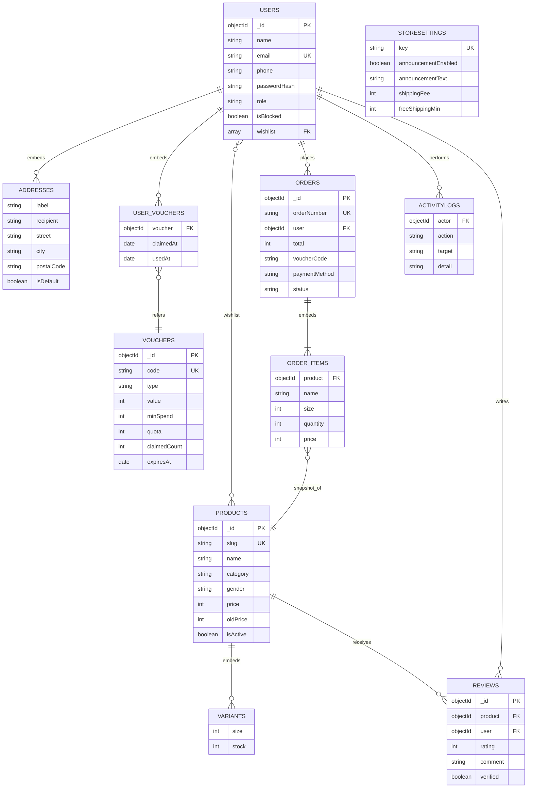

# RYTHM/ — Toko Sepatu Online

Website e-commerce sepatu dengan tampilan modern, dibangun dengan **Next.js (App Router)** dan **MongoDB**. Project ini dibuat untuk uji kompetensi dan mencakup alur belanja lengkap, dari daftar akun sampai pesanan, serta panel pengelolaan toko dengan tiga peran pengguna.

Seluruh tampilan website berbahasa Inggris. Dokumentasi ini ditulis dalam bahasa Indonesia.

## Teknologi

| Bagian      | Teknologi                                                       |
| ----------- | --------------------------------------------------------------- |
| Framework   | Next.js (App Router), React, TypeScript                         |
| Tampilan    | Tailwind CSS v4, lucide-react, View Transitions API             |
| Database    | MongoDB + Mongoose                                              |
| Autentikasi | JWT (jose) di cookie `httpOnly`, password di-hash dengan bcrypt |
| Seed data   | `tsx` (`npm run seed`)                                          |

Frontend dan backend berada dalam satu project. Backend ditulis sebagai API Route di `src/app/api`.

## Fitur per peran

### Pelanggan (`USER`)

- Daftar dua langkah (cek email, lalu isi data diri) dan login
- Profil: ubah nama dan nomor HP, buku alamat (maks. 5, ada alamat utama)
- Ganti password
- Wishlist tersimpan di akun
- Klaim voucher, dengan kuota dan masa berlaku
- Keranjang, checkout (pilih alamat, metode bayar, voucher), dan riwayat pesanan
- Batalkan pesanan sendiri selama masih berstatus _Awaiting confirmation_. Stok dan voucher otomatis dikembalikan
- Stok per ukuran tampil langsung di halaman produk
- **Koleksi**: tab kategori, filter ukuran EU dan sembunyikan stok habis, urutkan (unggulan, harga terendah/tertinggi, nama), dengan judul dan breadcrumb yang mengikuti kategori
- **Find your size** (`/fit`): ukur panjang kaki dengan slider (cm/inci, kaki normal/lebar), lalu dapat rekomendasi ukuran EU/US/UK dan langsung ke koleksi yang tersedia di ukuran itu
- Pencarian produk dengan hasil langsung saat mengetik (bisa dibuka dengan Cmd+K)
- Ulasan produk bintang 1–5, dengan label **Pembeli terverifikasi** bagi yang pernah memesan
- **Pusat bantuan** (`/help`): info pengiriman (ongkir mengikuti pengaturan toko) dan retur

### Admin (`ADMIN`)

Login sebagai admin langsung masuk ke panel admin (`/admin`). Panel admin punya tampilan sendiri, terpisah dari toko: sidebar menu, profil dengan badge peran, tombol keluar, dan link **View store** yang membuka toko di tab baru.

- **Dashboard**: pendapatan, jumlah pesanan, rata-rata nilai pesanan, pasang terjual (filter 7/30/90 hari, dibanding periode sebelumnya), grafik pendapatan harian, produk terlaris, penjualan per kategori, metode pembayaran, stok menipis
- **Produk**: tambah, edit, hapus, atur stok per ukuran (EU 38–45), tampilkan atau sembunyikan dari toko
- **Pesanan**: lihat semua pesanan dan ubah status secara berurutan (Awaiting confirmation → Processing → Shipped → Delivered, atau Cancelled). Pembatalan otomatis mengembalikan stok dan voucher
- **Ulasan**: hapus ulasan yang tidak pantas (moderasi)

### Superadmin (`SUPERADMIN`)

Semua fitur admin, ditambah:

- **Voucher**: buat, edit, aktif/nonaktifkan, atur kuota klaim, lihat statistik klaim, pemakaian, dan total potongan
- **Kelola admin (CRUD)**: tambah akun admin, lihat, edit nama/email/HP dan reset password, blokir/aktifkan, serta hapus akun admin. Superadmin hanya satu (dibuat oleh seed) dan role tidak bisa diubah dari panel
- **Pelanggan**: lihat semua pelanggan beserta jumlah pesanannya, serta blokir dan aktifkan akun. Akun pelanggan dibuat sendiri lewat halaman Sign up
- **Pengaturan toko**: teks pengumuman di atas navbar, ongkir, dan batas gratis ongkir. Langsung berlaku di keranjang, checkout, halaman bantuan, dan perhitungan total di server
- **Log aktivitas**: catatan siapa mengubah apa dan kapan (produk, stok, harga, status pesanan, tambah/edit/hapus admin, blokir akun, voucher, pengaturan toko, hapus ulasan)

Halaman yang tidak sesuai peran menampilkan 404, dan setiap API admin mengecek role langsung ke database.

## Daftar halaman

| Halaman                            | Alamat                                                                                       | Akses             |
| ---------------------------------- | -------------------------------------------------------------------------------------------- | ----------------- |
| Beranda                            | `/`                                                                                          | Semua             |
| Koleksi                            | `/shop`, `/men`, `/women`, `/new`, `/sale`                                                   | Semua             |
| Detail produk                      | `/shop/[slug]`                                                                               | Semua             |
| Pencarian                          | `/search?q=...`                                                                              | Semua             |
| Find your size                     | `/fit`                                                                                       | Semua             |
| Bantuan                            | `/help`                                                                                      | Semua             |
| Sign in / Sign up                  | `/login`, `/register`                                                                        | Belum login       |
| Checkout                           | `/checkout`                                                                                  | Pelanggan         |
| Akun                               | `/account`, `/account/orders`, `/account/wishlist`, `/account/vouchers`, `/account/settings` | Login             |
| Dashboard admin                    | `/admin`                                                                                     | Admin, superadmin |
| Produk & pesanan                   | `/admin/products`, `/admin/orders`                                                           | Admin, superadmin |
| Voucher, pengguna, log, pengaturan | `/admin/vouchers`, `/admin/users`, `/admin/activity`, `/admin/settings`                      | Superadmin        |

## Tampilan

- **Beranda**: slider sepatu dengan penggaris yang mengukur panjang sepatu (label ukuran EU dan cm) dan busur garis yang berubah dari abu-abu ke hitam selama slide berjalan
- **Kartu produk**: tab harga di pojok kanan atas, badge (_New_, _Best seller_, _Sale_, _Sold out_), dan tombol beli
- **Navbar**: menu di kiri, logo di tengah, cari/akun/keranjang di kanan
- **Transisi**: halaman baru masuk dari kanan saat pindah halaman, dan konten koleksi bergeser saat ganti kategori (View Transitions API, otomatis nonaktif jika pengguna memilih _reduce motion_)
- **Footer**: semua menu berfungsi (koleksi, lacak pesanan, cari ukuran, pengiriman, retur, media sosial)

## Struktur database

Database `rythm` berisi 7 koleksi. Alamat, wishlist, voucher milik user, ukuran/stok, dan item pesanan disimpan sebagai subdokumen (embedded).



| Koleksi         | Isi                                                      |
| --------------- | -------------------------------------------------------- |
| `users`         | Akun, role, alamat, wishlist, voucher yang diklaim       |
| `products`      | Produk dan stok per ukuran                               |
| `vouchers`      | Daftar voucher beserta kuota                             |
| `orders`        | Pesanan, dengan snapshot item dan alamat saat checkout   |
| `activitylogs`  | Catatan aktivitas admin dan superadmin                   |
| `reviews`       | Ulasan produk (satu ulasan per user per produk)          |
| `storesettings` | Pengaturan toko: pengumuman, ongkir, batas gratis ongkir |

**Kenapa snapshot di pesanan?** Nama, harga, gambar, dan alamat disalin saat checkout, supaya riwayat pesanan tidak berubah walau admin mengedit produk atau user menghapus alamat.

**Nilai gender di database.** Field `gender` produk tetap disimpan sebagai `Pria`, `Wanita`, atau `Unisex`, lalu ditampilkan sebagai _Men_, _Women_, dan _Unisex_. Pencarian kata "men" atau "women" ikut dipetakan ke nilai tersebut.

## Cara menjalankan

### Prasyarat

- Node.js 20.6 atau lebih baru
- MongoDB (lokal lewat Homebrew, atau MongoDB Atlas)

### Langkah

```bash
# 1. Clone dan install
git clone <url-repo> && cd shoes-store
npm install

# 2. Jalankan MongoDB (macOS + Homebrew)
brew tap mongodb/brew
brew install mongodb-community@8.0
brew services start mongodb/brew/mongodb-community@8.0

# 3. Buat file konfigurasi
cp .env.example .env.local
```

Buka `.env.local` lalu isi:

| Variabel                                             | Keterangan                                                       |
| ---------------------------------------------------- | ---------------------------------------------------------------- |
| `MONGODB_URI`                                        | Default `mongodb://127.0.0.1:27017/rythm`                        |
| `AUTH_SECRET`                                        | Isi dengan hasil `openssl rand -base64 32`                       |
| `SEED_SUPERADMIN_EMAIL` / `SEED_SUPERADMIN_PASSWORD` | Akun superadmin yang dibuat oleh seed (password min. 8 karakter) |
| `SEED_ADMIN_EMAIL` / `SEED_ADMIN_PASSWORD`           | Akun admin yang dibuat oleh seed                                 |

```bash
# 4. Isi data awal (produk, voucher, akun superadmin & admin)
npm run seed

# 5. Jalankan
npm run dev
```

Buka http://localhost:3000.

### Akun demo

| Peran      | Email                          | Password                          | Setelah login |
| ---------- | ------------------------------ | --------------------------------- | ------------- |
| Superadmin | sesuai `SEED_SUPERADMIN_EMAIL` | sesuai `SEED_SUPERADMIN_PASSWORD` | `/admin`      |
| Admin      | sesuai `SEED_ADMIN_EMAIL`      | sesuai `SEED_ADMIN_PASSWORD`      | `/admin`      |
| Pelanggan  | daftar sendiri di `/register`  |                                   | Beranda       |

`npm run seed` aman dijalankan berulang kali. Seed hanya mengisi data yang belum ada dan tidak menimpa perubahan dari panel admin. Artinya, teks produk dan pengumuman yang sudah tersimpan di database tidak ikut berubah saat seed dijalankan ulang; ubah lewat panel admin.

### Voucher bawaan

| Kode        | Potongan             | Min. belanja | Kuota       |
| ----------- | -------------------- | ------------ | ----------- |
| `WELCOME10` | 10%, maks. Rp150.000 | Rp500.000    | Tanpa batas |
| `HEMAT100`  | Rp100.000            | Rp1.500.000  | 50          |
| `SALE15`    | 15%, maks. Rp250.000 | Rp1.000.000  | 100         |

## Struktur folder

```text
shoes-store/
├── scripts/
│   └── seed.ts            # Isi data awal (npm run seed)
├── public/
│   └── shoes/             # Gambar produk
└── src/
    ├── app/
    │   ├── account/       # Halaman akun pelanggan
    │   ├── admin/         # Panel admin & superadmin (layout sendiri)
    │   ├── api/           # Backend (API Route)
    │   ├── checkout/      # Halaman checkout
    │   ├── fit/           # Find your size
    │   ├── help/          # Pusat bantuan (pengiriman & retur)
    │   ├── shop/          # Koleksi & detail produk
    │   ├── login/         # Sign in
    │   ├── register/      # Sign up
    │   ├── search/        # Hasil pencarian
    │   ├── men, women, new, sale/
    │   └── template.tsx   # Animasi saat pindah halaman
    ├── components/        # Komponen UI (termasuk components/admin dan AdminNav)
    ├── lib/               # Auth, koneksi DB, katalog, harga, voucher, helper
    ├── models/            # Skema Mongoose
    └── views/             # Halaman besar (Beranda, Koleksi, Produk, Auth)
```

## Keamanan

- Password disimpan sebagai hash bcrypt dan tidak pernah dikirim ke browser
- Sesi berupa JWT di cookie `httpOnly`, sehingga tidak bisa dibaca JavaScript
- Role tidak pernah diambil dari input. Akun dari halaman Sign up selalu `USER`, akun yang dibuat superadmin selalu `ADMIN`, dan superadmin hanya satu dari seed
- Pengalihan admin ke `/admin` setelah login dicek di server berdasarkan sesi, bukan dari browser
- Setiap request mengecek status akun ke database, jadi akun yang diblokir atau dihapus langsung dianggap keluar
- Harga, stok, voucher, dan ongkir selalu dihitung ulang di server saat checkout
- Klaim kuota voucher dan pengurangan stok dilakukan secara atomik di database
- `.env.local` tidak ikut ter-commit. Gunakan `.env.example` sebagai contoh

## Perintah

| Perintah           | Fungsi                       |
| ------------------ | ---------------------------- |
| `npm run dev`      | Menjalankan mode development |
| `npm run seed`     | Mengisi data awal            |
| `npm run build`    | Build untuk production       |
| `npx tsc --noEmit` | Cek error TypeScript         |
